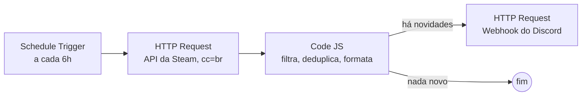
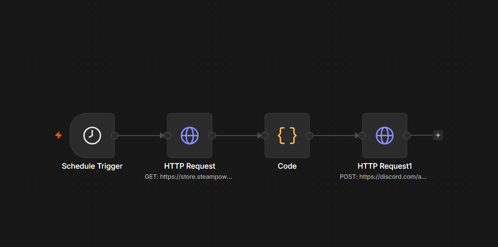
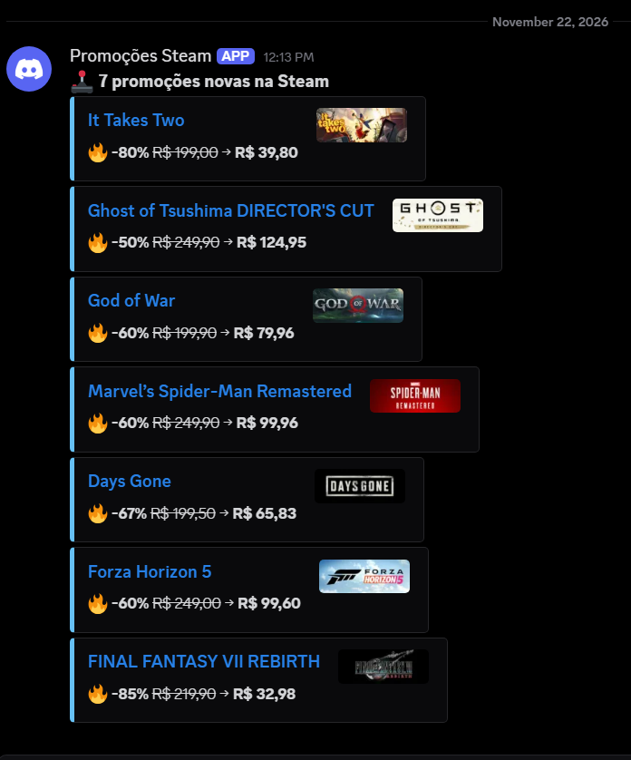

# 🎮 Automação n8n: alertas de promoções da Steam no Discord

Workflow no n8n que monitora a loja da Steam e envia ao Discord, automaticamente, apenas as promoções novas com desconto relevante, já em reais (BRL).

## 1. Problema

Jogos na Steam entram e saem de promoção o tempo todo, e boas ofertas duram poucos dias. Acompanhar isso manualmente tem três problemas:

- **Dependência de lembrar de abrir a loja.** Ofertas boas são perdidas.
- **Ruído.** A loja mostra centenas de itens, a maioria com desconto pequeno.
- **Preço em outra moeda ou desatualizado** em sites agregadores.

**Objetivo:** receber no Discord só o que importa, sem repetição, em reais e com link direto para a compra.

## 2. Solução

| Nó | Função |
|---|---|
| **Schedule Trigger** | Dispara o fluxo a cada 6 horas. |
| **Steam API** | `GET https://store.steampowered.com/api/featuredcategories?cc=br&l=portuguese` retorna as promoções em destaque em BRL. |
| **Filtrar promoções** | Mantém desconto ≥ `MIN_DISCOUNT` (50%), ignora jogos já avisados com o mesmo desconto (memória em `staticData`, limpa após 14 dias), converte centavos em `R$ 0,00`, monta *embeds* do Discord e divide em lotes de 10 (limite da API). Se não há novidade, retorna vazio e o fluxo encerra sem enviar nada. |
| **Enviar para Discord** | `POST` no webhook, uma mensagem por vez com intervalo de 1,5 s para respeitar o rate limit. |

## 3. Regras de negócio

1. Só entram promoções com `discount_percent >= MIN_DISCOUNT`.
2. A chave de deduplicação é `idDoJogo-percentualDeDesconto`. Se o desconto do mesmo jogo mudar, ele é avisado de novo.
3. Registros de deduplicação expiram em 14 dias.
4. Cada mensagem do Discord tem no máximo 10 cards.
5. Sem promoções novas, nenhuma mensagem é enviada.

## 4. Evidências

### Canvas do workflow

### Mensagem recebida no Discord

