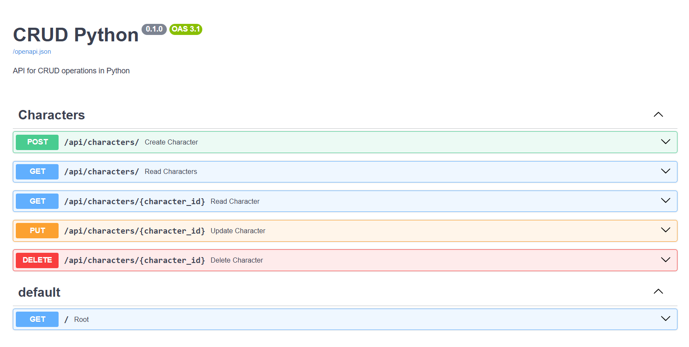
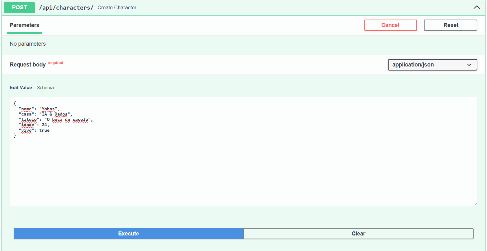
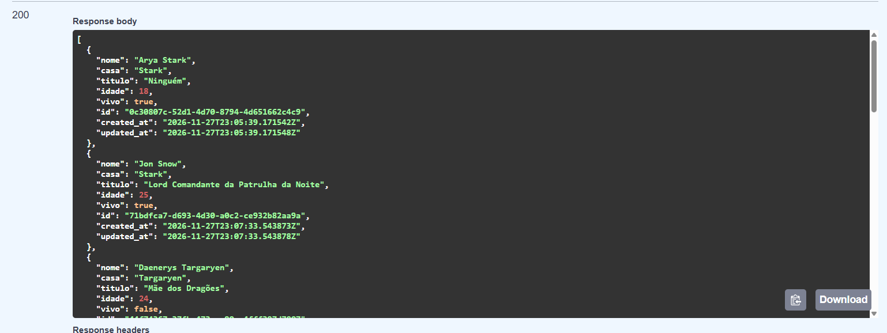
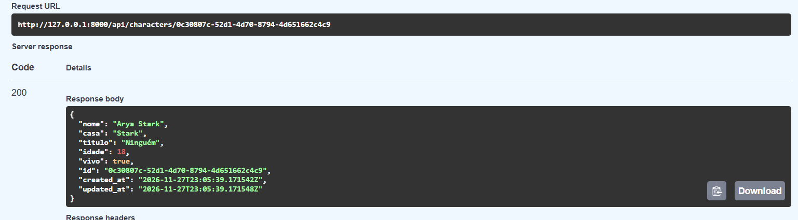
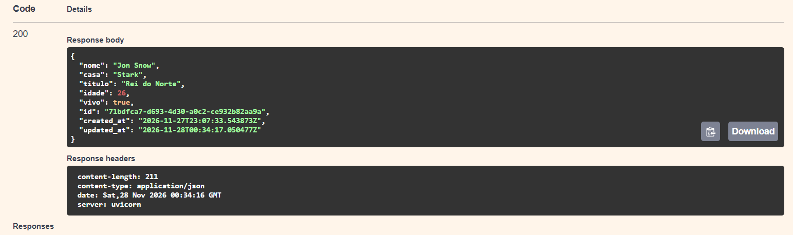
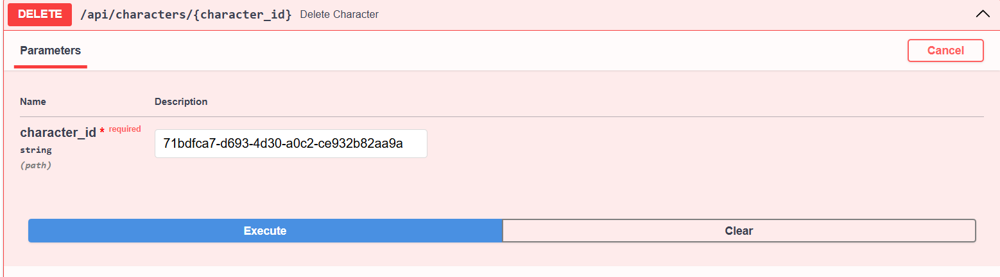

# CRUD Python: API de Personagens de Game of Thrones

## Tecnologias
 
- Python 3.10+
- FastAPI
- SQLModel / SQLAlchemy
- SQLite
- Uvicorn

## Estrutura do projeto
```
.
├── main.py
├── requirements.txt
├── got.db             # criado automaticamente na primeira execução
├── docs/              # prints da API funcionando
└── app/
    ├── __init__.py
    ├── database/
    │   ├── __init__.py
    │   └── config.py    # engine, sessão e criação das tabelas
    ├── models/
    │   ├── __init__.py
    │   └── got.py       # modelos Character, Create, Read e Update
    └── routes/
        ├── __init__.py
        └── characters.py
```

## Modelo de dados
 
| Campo | Tipo | Descrição |
|---|---|---|
| `id` | string (UUID) | Gerado automaticamente |
| `nome` | string | Obrigatório |
| `casa` | string | Obrigatório |
| `titulo` | string \| null | Opcional |
| `idade` | inteiro ≥ 0 | Opcional (padrão `0`) |
| `vivo` | booleano | Opcional (padrão `true`) |
| `created_at` | datetime | Gerado automaticamente |
| `updated_at` | datetime | Atualizado a cada `PUT` |

## Endpoints
 
| Método | Rota | Descrição | Sucesso | Erros |
|---|---|---|---|---|
| `GET` | `/` | Mensagem de boas-vindas | `200` | n/a |
| `POST` | `/api/characters/` | Cria um personagem | `201` | `422` |
| `GET` | `/api/characters/` | Lista personagens (com paginação e filtro) | `200` | `422` |
| `GET` | `/api/characters/{character_id}` | Busca um personagem pelo ID | `200` | `404` |
| `PUT` | `/api/characters/{character_id}` | Atualiza todos os campos de um personagem | `200` | `404`, `422` |
| `DELETE` | `/api/characters/{character_id}` | Remove um personagem | `204` | `404` |

### Parâmetros do `GET /api/characters/`
 
| Parâmetro | Tipo | Padrão | Descrição |
|---|---|---|---|
| `offset` | int | `0` | Quantos registros pular |
| `limit` | int | `100` | Máximo de registros retornados |
| `vivo` | bool | n/a | Filtra por personagens vivos (`true`) ou mortos (`false`) |

### Exemplos
 
**Criar um personagem**
 
```bash
curl -X POST http://localhost:8000/api/characters/ \
  -H "Content-Type: application/json" \
  -d '{
    "nome": "Jon Snow",
    "casa": "Stark",
    "titulo": "Lord Comandante",
    "idade": 25,
    "vivo": true
  }'
```
 
Resposta (`201`):
```json
{
  "nome": "Jon Snow",
  "casa": "Stark",
  "titulo": "Lord Comandante",
  "idade": 25,
  "vivo": true,
  "id": "3f2b8c1e-5d4a-4b6e-9a7c-1e2d3c4b5a69",
  "created_at": "2026-11-27T23:03:45.123456Z",
  "updated_at": "2026-11-27T23:03:45.123456Z"
}
```
**Listar apenas personagens vivos, 10 por página**
 
```bash
curl "http://localhost:8000/api/characters/?vivo=true&limit=10&offset=0"
```
**Buscar por ID**
 
```bash
curl http://localhost:8000/api/characters/<character_id>
```
**Update (todos os campos são obrigatórios no `PUT`)**
 
```bash
curl -X PUT http://localhost:8000/api/characters/<character_id> \
  -H "Content-Type: application/json" \
  -d '{"nome": "Jon Snow", "casa": "Stark", "titulo": "Rei do Norte", "idade": 26, "vivo": true}'
```
**Remover**
 
```bash
curl -X DELETE http://localhost:8000/api/characters/<character_id>
```
## Prints do `/docs`
### Visão geral das rotas


### POST: criar personagem
Yohas agora existe no banco de dados, você pode checar isso em `got.db`

 
### GET: listar personagens


### GET: buscar por ID


### PUT: atualizar personagem
 Titulo anterior: Lord Comandante da Patrulha da Noite

 
### DELETE: remover personagem
Jon Snow foi removido do banco de dados, você pode checar isso acessando `got.db`


## Como instalar
### 1. Baixar e extrair o projeto
1. Baixe o arquivo `.zip` do projeto.
2. Extraia o conteúdo para uma pasta do seu computador (clique com o botão direito no arquivo e escolha **Extrair tudo**).
3. Abra a pasta extraída no terminal (ou no VS Code) e entre nela:

```bash
cd caminho/para/a-pasta-do-projeto
```
> Confirme que o `main.py` está diretamente nessa pasta. Se o zip criou uma pasta dentro de outra, entre na mais interna.
### 2. Criar e ativar o ambiente virtual
 
**Windows (PowerShell):**
 
```powershell
python -m venv .venv
.venv\Scripts\Activate.ps1
```
 
**Linux / macOS / Git Bash:**
 
```bash
python -m venv .venv
source .venv/bin/activate
```
### 3. Instalar as dependências
 
```bash
pip install -r requirements.txt
```
 
### 4. Rodar a API
 
Na raiz do projeto (onde está o `main.py`):
 
```bash
uvicorn main:app --reload
```
 
Ou:
 
```bash
python main.py
```
A API fica disponível em `http://localhost:8000`.
 
O arquivo `got.db` e a tabela `character` são criados automaticamente quando a aplicação inicia.
 
> **Atenção:** se você alterar os modelos em `app/models/got.py`, apague o `got.db` para o banco ser recriado com o schema novo.
